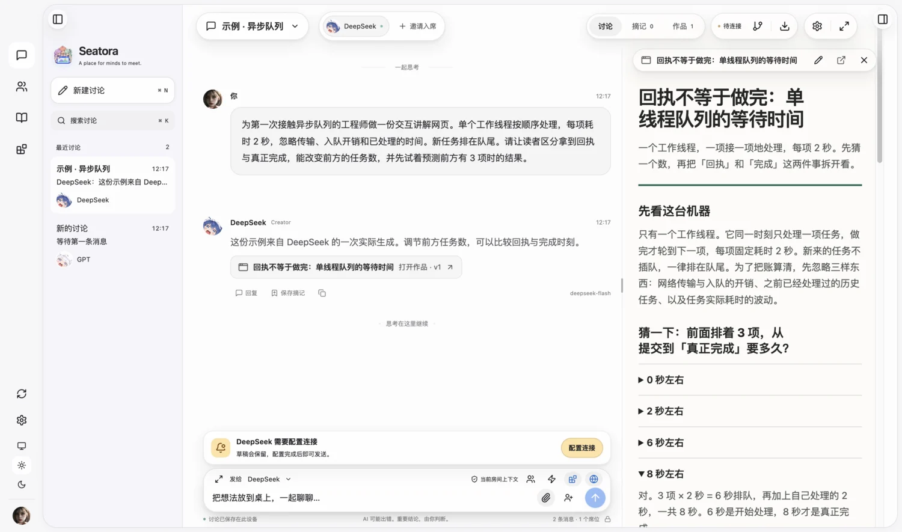
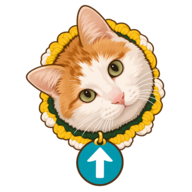

  <picture>
    <source media="(prefers-reduced-motion: reduce)" srcset="assets/seatora.png">
    
  </picture>
  <h1>Seatora</h1>
  
<strong>Turn a discussion into a webpage your reader can actually try.</strong>

  
macOS · Windows &nbsp;｜&nbsp; Local-first &nbsp;｜&nbsp; Bring your own AI

  
<a href="https://github.com/ababdotai/seatora-releases/releases/latest">Download</a> · <a href="#getting-started">Getting started</a> · <a href="https://github.com/ababdotai/seatora-releases/issues">Feedback</a> · <a href="README.zh-CN.md">中文</a>

## What can a page explain?

Imagine explaining a job queue to a new teammate. “The server immediately acknowledges the request” sounds reassuring. How long until the work is actually done? Give Seatora your notes and ask a companion to make a page where readers can predict the answer, then change the queue length to test it.

| Jobs ahead | Acknowledged | My job starts | My job finishes |
| --- | --- | --- | --- |
| 0 | Around 0 s | 0 s | 2 s |
| 3 | Around 0 s | 6 s | 8 s |

Assume one worker, two seconds per job, and negligible transport and enqueue times. Three extra jobs barely change the acknowledgment time, yet completion moves six seconds later.

## Getting started

1. **Connect a companion.** Open connection settings (连接设置) and configure a model API or a locally installed, signed-in Codex or Claude Code CLI. Start a discussion and pick a companion.
2. **Bring your material.** Paste an idea, a Markdown passage or a technical brief. To build on an existing conversation, open its title menu and select 用讨论创作网页. Say who will read the page and what question they should be able to answer.
3. **Try the page and revise it.** Open the work from a reply and test it beside the conversation. Select 修订此版本 on the version you want to change. The room’s shelf (作品) opens the latest version. The original message opens the version it introduced.

Try this as your first message:

> Make a page for an engineer learning about queues. One worker takes two seconds per job. Ask the reader when their job will finish with three jobs ahead. Then let them change the queue length and compare acknowledgment time with completion time.

## What stays in a room?

| In the room | What you can do |
| --- | --- |
| **Companions** | Invite a second opinion with shared context, or ask someone to read independently. Turn on team mode to arrange roles for a particular turn. |
| **Topics and notes** | Branch into a topic from a message. Save a reply as a note and find it again at the top of the room. |
| **Works and versions** | Keep several pages in the same room. Each has its own revision history on the shelf. |
| **Markdown export** | Use 导出讨论 in the title menu to take the written discussion with you. |

## Install and update

Download an installer from the assets on the [latest release](https://github.com/ababdotai/seatora-releases/releases/latest).

| Computer | Installation |
| --- | --- |
| Apple silicon Mac | Open the file ending in `macOS-arm64.dmg` and drag Seatora into Applications. |
| Windows x64 | Run the installer ending in `Windows-x64-Setup.exe`. |

The Mac application is ad-hoc signed and has not been notarized by Apple. The Windows installer is unsigned.

Seatora checks on each launch and every 24 hours while running. The circular arrow above Settings lets you check at any time. When a release is available, the arrow turns into this cat. Click it to see the version, then choose Download to select a destination. Seatora checks the file size and SHA-256 before offering to reveal it for installation.

 

## Where does my work go?

Discussions, notes and generated pages live in a local database on your computer. When you ask for a reply or a page, relevant context goes to your selected model service or local CLI. If you enable web search or image generation, those services receive the search query or illustration prompt. Downloading Seatora requires no account. Your model provider determines its own account requirements and charges.
