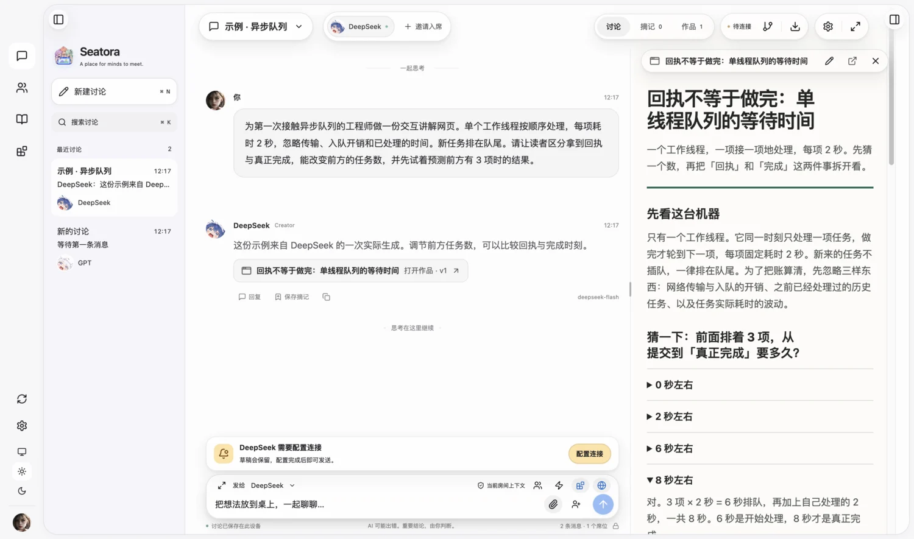

  <picture>
    <source media="(prefers-reduced-motion: reduce)" srcset="assets/seatora.png">
    
  </picture>
  <h1>Seatora · 共席</h1>
  
<strong>把一段没讲透的讨论，做成读者能亲手试的网页。</strong>

  
macOS · Windows &nbsp;｜&nbsp; 本地优先 &nbsp;｜&nbsp; 接入自己的 AI 伙伴

  
<a href="https://github.com/ababdotai/seatora-releases/releases/latest">下载桌面版</a> · <a href="#第一次使用">第一次使用</a> · <a href="https://github.com/ababdotai/seatora-releases/issues">反馈</a> · <a href="README.md">English</a>

## 一张网页怎么把事情讲明白？

假设你要向新同事解释异步队列。文档写着「提交后马上收到回执」，读者可能以为事情已经做完。你可以把这段材料交给 Seatora，请 AI 伙伴把两个时刻放进同一张网页，让读者先猜，再改动排队数看结果。

| 前面有几项任务 | 收到回执 | 轮到我开始 | 我的任务完成 |
| --- | --- | --- | --- |
| 0 项 | 约 0 秒 | 第 0 秒 | 第 2 秒 |
| 3 项 | 约 0 秒 | 第 6 秒 | 第 8 秒 |

这个例子只有一个工作线程，每项固定耗时 2 秒，忽略传输和入队时间。把前方任务从 0 调到 3，回执几乎一样快，真正完成却晚了 6 秒。

## 第一次使用

1. **请一位伙伴入席。** 安装并打开 Seatora，在「连接设置」接入自己的模型 API，或选择本机已安装并登录的 Codex 或 Claude Code。新建讨论，选择一位伙伴。
2. **把材料放到桌上。** 粘贴一个想法、一段 Markdown 或报告片段。已经聊出结论时，可以在讨论标题菜单选择「用讨论创作网页」。说明读者是谁，以及希望读者看完能回答哪个问题。
3. **边看边改。** 点击回复中的作品，在讨论旁试用网页。挑一版点「修订此版本」，告诉伙伴具体哪里容易误解。之后从房间顶部的「作品」回到最新版，从原消息仍能打开当时的版本。

可以直接发给伙伴试试：

> 给第一次接触队列的工程师做一页讲解。一个线程，每项 2 秒。先让读者猜前面有 3 项时会在第几秒完成，再让他拖动排队数，同时观察回执和完成时刻。

## 一场讨论可以留下什么？

| 在房间里 | 你可以做什么 |
| --- | --- |
| **伙伴与分工** | 邀请另一位伙伴接着讨论，或请它独立看材料。打开输入框的「团队」可为这一轮安排分工。 |
| **话题与摘记** | 从一条消息展开话题，把值得留下的回复保存为摘记。房间顶部可以随时翻阅。 |
| **作品与版本** | 在同一房间创作多张网页，分别修订。作品架保留每件作品的版本，方便回看。 |
| **带走文字** | 在标题菜单选择「导出讨论」，得到一份 Markdown。 |

## 安装与更新

从[最新发布页](https://github.com/ababdotai/seatora-releases/releases/latest)的附件中选择安装包。

| 电脑 | 下载与安装 |
| --- | --- |
| Apple 芯片的 Mac | 下载文件名以 `macOS-arm64.dmg` 结尾的磁盘映像，打开后把 Seatora 拖进「应用程序」。 |
| 64 位 Windows（x64） | 下载文件名以 `Windows-x64-Setup.exe` 结尾的安装程序，双击运行。 |

当前 Mac 安装包使用本地签名，尚未经过 Apple 公证。Windows 安装包未签名。

桌面版每次启动时检查更新，持续运行时每 24 小时再查一次。左下角设置上方的循环箭头也可以手动检查。有新版时，它会变成绿色圆形下载图标。点击图标查看版本，再选「下载更新」和保存位置。从 v0.1.3 起，通过文件大小和 SHA-256 校验后，Mac 会自动打开磁盘映像，Windows 会启动安装向导，在系统窗口内完成安装即可。如果系统未能打开安装包，还可以打开所在文件夹。

 

## 数据放在哪里？

讨论、摘记和网页作品保存在电脑上的本地数据库。请求 AI 回复或创作时，相关材料会发给你选定的模型服务或本地 CLI。启用联网搜索或作品配图时，对应服务会收到搜索词或配图提示。下载 Seatora 无需注册账号，使用模型所需的账号、密钥与费用由你选择的服务决定。
